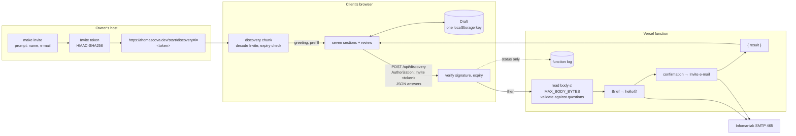

# Plan: increment-2

Status: draft, 2026-11-05 (Phase 2, guide §4.2). Spec: `docs/spec/increment-2.md`, approved 2026-11-05
(commit ad7db39). Inputs: issues #59 and #67 with their comments, constitution v1.1, ADR 0003, 0006,
0010, 0011, 0012, 0016. The Owner's plan-mode review of 2026-11-05 decided the two Blockers of §11 and
five fixes to the first draft; they are folded in below.

Vocabulary is `GLOSSARY.md`. Spec words the glossary does not define yet (the *sticky bar*, the
*hero* and its *backdrop*, *the function*, the *review step*, the *Start a project* control) are
used as the spec writes them; the glossary addition is a hand-off (§12).

## Context

The spec fixes what increment-2 is: one redesign of the whole site on one dark token set (#67,
T0), a plain-HTML /start, and the invited English Discovery Form at /start/discovery with a Draft
in the Client's browser, an invite CLI the Owner runs on the host, and one serverless function
that verifies the Invite and sends two plain-text mails. increment-1 is live and its automated
acceptance criteria keep holding (AC-1.5).

This plan decides the how: module boundaries for the new code, five ADRs, the Invite, Draft,
question and Brief formats, the wire contract between page and function, the test per acceptance
criterion, what is logged and kept where, the risks in order and the ticket slices. The Owner's
budget is about 4 hours a week.

## 1. Scope

**Spec sections covered**: every user story US-1 … US-16 and every acceptance criterion AC-1.1 …
AC-16.3 (mapping in §6), the Non-functional requirements, the Data & privacy classification, the
Implementation decisions, the Testing decisions and the Constraints & dependencies.

**Inputs the spec handed to the plan, decided here**:

| # | question | decision | where |
|---|---|---|---|
| 1 | wire encoding of the four response classes | a fixed JSON body field `result`; status codes are conventional only | §5, ADR 0020 |
| 2 | body size limit | the named constant `MAX_BODY_BYTES` in the shared module, proven against the largest legal body built from the real question schema | §4, §5, §6 |
| 3 | a handler form that leaves the body unread until the Invite verifies | the Web-standard `POST(request: Request)`; the body stream is read only after verification, with a byte counter | §5, ADR 0020, risk 4 |
| 4 | the counting unit of the 80-character name cap | code points after NFC, one function shared by CLI, page and function; the text caps use the same unit | §4 |
| 5 | how `make invite` reaches Node 24 on the host | the host's own Node 24 when present, else `make invite` inside the devcontainer image; name and e-mail from a prompt | §5, ADR 0019 |
| 6 | what Vercel's request log records for a request header | what the docs state now, and the probe the function ticket runs | §8 |
| 7 | the font | the measurement T0a takes; the Owner picks on the preview | §3, §6 |
| 8 | new dependencies | the table in §3 | §3 |

**Non-goals carried over from the spec, unchanged**: the public short intake, German, a PDF Brief,
a copy of the answers to the Client, legal pages, prefill from an intake, resuming on another
device, revising after submit, a script-free Discovery Form, per-IP rate limiting, an alert on a
failed send (all Deferred, gathered in #91); World shaders and polish (#68, #43). Refused: a
third-party form service, a captcha, analytics, a database for Briefs, a Brief anywhere in this
repository or an agent's context, single-use Invites, another Vercel project.

**Owner dependencies, due before the ticket that consumes them** (§10): the redrawn Puck mark (T0a),
the font pick on T0a's preview, the /start sentence (T1), the final EN copy of the seven sections
(T3b; the agent drafts the diff from the mockup's text in that ticket), the signing secret and the
mailbox's device password in Vercel's environment and on the host (T5), one real send (T5).

## 2. Architecture

A static site of four pre-rendered documents and one serverless function. Everything else happens
at build time or in the browser.

| document | built from | script |
|---|---|---|
| `/` (`dist/index.html`) | pre-rendered Title Screen (the hero) + the `site` chunk, which hydrates it and lazy-loads `world` | as increment-1 |
| `/exhibits` | pre-rendered Fallback Page | none |
| `/start` (`dist/start/index.html`) | pre-rendered /start page | none |
| `/start/discovery` (`dist/start/discovery/index.html`) | pre-rendered shell: the no-script message (AC-6.5) and the consent statement (AC-9.3) + the `discovery` entry chunk | yes: the Discovery Form renders on the client (`createRoot`, not `hydrateRoot`) |
| `POST /api/discovery` | `api/discovery.ts`, a Vercel Node function | n/a |

### Module boundaries

| module | directory | owns | must not import |
|---|---|---|---|
| **tokens and site CSS** | `src/site/tokens.css`, `src/site/site.css` (replaced, Tailwind v4 entry) | the one dark token set; every colour literal of the HTML surfaces lives in `tokens.css` | — |
| **site** | `src/site/` | as increment-1, re-skinned; adds `StickyBar`, `Hero` (backdrop + headline), `StartPage`, `Mark` (the Puck drawing) and the copied shadcn/ui primitives under `src/site/ui/` | three, Rapier, the World model, `src/intake/server/`, `src/discovery/` |
| **intake (shared, pure)** | `src/intake/` | Invite decode and the field rules, the question types, answer validation, the Brief text, `MAX_BODY_BYTES`, the result classes | React, the DOM, `node:*`, three |
| **intake (server)** | `src/intake/server/` | HMAC sign and verify (`node:crypto`), the handler factory, the send module (nodemailer) | React, the DOM |
| **discovery (page)** | `src/discovery/` | the Discovery Form components and its pure state: sections, navigation, progress, review, the Draft, the submit classifier; `main.tsx` is the `discovery` entry | three, Rapier, `src/intake/server/`, `src/app/` |
| **content** | `content/`, `src/content/` | adds `content/discovery.yaml` (the seven sections' questions) and the /start sentence in `site.yaml`, each with its zod schema; validated at build | as increment-1 |
| **function** | `api/discovery.ts` | glue only: reads the environment, builds the handler from `src/intake/server/`, exports `POST` | React, the DOM, `src/discovery/` |
| **invite CLI** | `scripts/invite.ts` | prompt, mint, print the link | anything outside `node:*` and `src/intake/` |
| app, world, perf, build | as increment-1 | `build/prerender.ts` gains the two routes (ADR 0018) | as increment-1 |

The `discovery` chunk and the function share `src/intake/` as source, never at runtime. The root
address's chunks never contain `src/intake/` or `src/discovery/` code (AC-16.2); the build half
proves it as T1 proved the `world` isolation.

### Data flow



### Entry into the World (US-2) without Motion

The Title Screen today leaves with the `hidden` attribute (`src/site/TitleScreen.tsx`), which cannot
transition. T0b replaces it with a state class that transitions `opacity` and `transform` (the fade
and lift) and `visibility` with a delay equal to the duration, plus `inert`, the way the World
section already hides (plan increment-1, §5 corrected by T5b). The World section fades in by the
same rule. Under `prefers-reduced-motion: reduce` the existing site-wide rule sets `transition` and
`animation` to `none`, so both are instant (AC-2.4). The headline reveal is a CSS keyframe animation
whose resting state is the visible headline, so a page without script shows the headline (AC-2.2)
and the pre-rendered HTML carries no `style` attribute (ADR 0012). Motion is therefore not added
(Owner decision, §11 B2).

## 3. Stack decisions

| decision | where recorded |
|---|---|
| Stack, hosting, headers, content pipeline unchanged | ADR 0003, 0006, 0011, 0012 |
| **Design system: Tailwind v4, shadcn/ui copied in, Lucide, one dark token file, one self-hosted variable font; motion in CSS** | **ADR 0017 (new stub)** |
| **Four pre-rendered documents; the Discovery Form is its own entry, client-rendered** | **ADR 0018 (new stub)** |
| **The Invite token and `make invite`** | **ADR 0019 (new stub)** |
| **The function's contract: Web handler, Invite header, result field, body limit, send module** | **ADR 0020 (new stub)** |
| **A third test seam: the function under Node with SMTP mocked** | **ADR 0021 (new stub)** |

### ADR stubs

**ADR 0017 — Design system: Tailwind v4, copied shadcn/ui, Lucide, one dark token set, CSS motion.**
*Context*: the spec's Implementation decisions › "Design system (T0, #67, D1–D8)" ask for one
redesign of every HTML surface on one token set, with exactly two effects, without giving up the
pre-rendered, hydration-identical Title Screen, the CSP of ADR 0012 (no `style` attribute in
pre-rendered HTML, `font-src 'self'`) or the perf budget. *Decision*: Tailwind CSS v4 through
`@tailwindcss/vite`, its default palette cleared, every colour a custom property in
`src/site/tokens.css` (navy base, one electric-blue accent); `site.css` replaced, not layered;
shadcn/ui components copied by hand into `src/site/ui/` (no shadcn CLI) with their peers `radix-ui`,
`class-variance-authority`, `clsx`, `tailwind-merge`; Lucide React as the one icon set; one
Latin-subset variable woff2 (Geist Sans or Manrope, the Owner's pick on T0a's preview) served from
the site's origin; the headline reveal and the Title Screen–World crossfade in CSS transitions and
keyframes, switched off by the existing `prefers-reduced-motion` rule. *Consequences*: ADR 0012's
"System fonts" consequence no longer holds (a note on 0012 in T0a; `font-src 'self'` already
allows it); no Motion dependency, by the spec amendment of §11 B2; Radix primitives stay out of the
root's chunks unless a surface there needs one; a new colour is a token, never a literal, and the
build half enforces it (AC-1.1).

**ADR 0018 — Four pre-rendered documents; the Discovery Form is its own client-rendered entry.**
*Context*: ADR 0010 pre-renders two routes; the spec's Implementation decisions › "Routes" add /start
(plain HTML, no script) and /start/discovery (its own chunk, script required, with pre-rendered
consent and no-script message), and AC-16.2 keeps the form's code out of the root. *Decision*:
`build/prerender.ts`'s `ROUTES` gains `/start` (`script: false`, the Fallback shell) and
`/start/discovery` (a third shell that links the `discovery` entry only); Vite builds a second
client entry `src/discovery/main.tsx`; that page renders its pre-rendered shell, then mounts the form
with `createRoot` into its own container, since what the page shows depends on the fragment, which
the build cannot know. *Consequences*: no hydration mismatch is possible on that page; the build half
checks the four documents and the chunk graph; ADR 0010 gets a note that the route count is ADR
0018's; `vercel.json`'s `cleanUrls` already serves both paths.

**ADR 0019 — The Invite token and `make invite`.**
*Context*: ADR 0016 and the spec's Implementation decisions › "Invite (Q10, ADR 0016)" fix an
HMAC-signed token in the URL fragment carrying name, e-mail, language and expiry, minted on the
Owner's host without the name or e-mail in shell history; CLAUDE.md says a host without Node 24 runs
make through the devcontainer image. *Decision*: token = `base64url(JSON payload)` `.`
`base64url(HMAC-SHA256(secret, first part))`, payload `{ v: 1, n, e, l: 'en', x }` with `x` the expiry
in Unix seconds; the link is `<origin>/start/discovery#i=<token>`; one field-rule module
(`src/intake/invite.ts`: name 1–80 code points after NFC with no control character, U+0085, U+2028
or U+2029; exactly one address) shared by CLI, page and function, and the signing half in
`src/intake/server/sign.ts` (`node:crypto`, `timingSafeEqual`); `make invite` runs
`node scripts/invite.ts`, which needs no `node_modules`, reads the secret from `INVITE_SECRET`, the
name and e-mail from a prompt, `DAYS` and `ORIGIN` from make variables; with a Node older than 24 it
fails and prints the devcontainer-image command, which passes the secret by name
(`-e INVITE_SECRET`). *Consequences*: the page can decode and expiry-check but never verify;
rotating `INVITE_SECRET` ends every open Invite; the runbook `docs/runbooks/invite.md` holds the
commands.

**ADR 0020 — The function's contract.**
*Context*: the spec's Implementation decisions › "The function (Q12–Q14, ADR 0016)" order the
function (Invite check before the body is read, then size, validation, Brief, confirmation, answer),
name four response classes and leave their wire encoding, the body limit and the handler form to the
plan; Vercel's docs say the legacy `req.body` is a lazy getter and say nothing about buffering a Web
`Request`. *Decision*: `api/discovery.ts` exports `POST(request: Request): Promise<Response>`; the
Invite travels as `Authorization: Invite <token>`; the handler verifies it before touching
`request.body`, rejects a `Content-Length` above `MAX_BODY_BYTES`, then reads the stream with a byte
counter that cancels at the limit; every answer is JSON `{ "result": … }` with one of `accepted`,
`invite-rejected`, `request-rejected`, `send-failed`, and the page decides on that field alone; a
response without it (Vercel's own 413, 500 or 504, a network error) is handled as `send-failed`; the
send step is one module (`src/intake/server/send.ts`) over nodemailer, injected into the handler.
*Consequences*: only an explicit `invite-rejected` from the function clears the Draft (spec, "The
function": "Invite rejected … the Draft cleared"; "request rejected … the Draft kept"; "send failed …
the Draft kept"; and "Draft (Q5, principle 10, ADR 0016)": "A failed Brief, a rejected request … leave
it as it is"); a platform answer can never cost the Client their Draft; the Web signature is what the
seam calls, so seam 3 needs no Vercel SDK.

**ADR 0021 — A third test seam: the function under Node with SMTP mocked.**
*Context*: CLAUDE.md allows two seams (the built site in a browser, the World model under Node); the
spec's Testing decisions › "Seams" add a third, the function called as Vercel calls it with the SMTP
transport mocked; the Owner approved it in the plan-mode review of 2026-11-05 (§11 B1). *Decision*:
`tests/function/` is a Vitest project `function`; each test builds a `Request`, calls the handler built
with an in-memory send module, a fixed clock and a captured log, and asserts the `Response`, the mails
handed to the mock and the log lines; the CLAUDE.md and AGENTS.md "Two seams only" lines become three
in the PR that first adds the directory (T5), reviewed as a protected change. *Consequences*: still no
jsdom and no component tests; the CLI's tests stay in the `unit` project; the seam proves what the
function hands to SMTP, never delivery, which stays the Owner's one real send.

### Dependencies this plan adds, each in the ticket that first uses it, listed in that PR body

Researched against npm on 2026-11-05 at the newest version the toolchain's peer ranges accept; the
installing ticket re-checks types shipped and install scripts against the newest version then.

| package | version | licence | reason | ticket |
|---|---|---|---|---|
| `tailwindcss` | 4.3.4 | MIT | tokens, layout, responsive design (#67) | T0a |
| `@tailwindcss/vite` | 4.3.4 | MIT | Tailwind's Vite plugin; peer `vite ^5.2 \|\| ^6 \|\| ^7 \|\| ^8` accepts the pinned 8.3.6 | T0a |
| `lucide-react` | 1.69.0 | ISC | the one icon set (#67); peer React ^19 accepted | T0a |
| `class-variance-authority` | 0.7.1 | Apache-2.0 | variants of the copied shadcn/ui components | T0a |
| `clsx` | 2.1.1 | MIT | class composition (shadcn/ui `cn`) | T0a |
| `tailwind-merge` | 3.7.0 | MIT | class conflict resolution (shadcn/ui `cn`) | T0a |
| `@fontsource-variable/geist` **or** `@fontsource-variable/manrope` | 5.3.0 | OFL-1.1 (licence read from each package's `LICENSE` and its source repository at install) | the one font file; only the Owner's pick is installed | T0a |
| `radix-ui` | 1.8.1 | MIT | accessible primitives under the copied shadcn/ui form controls (checkbox, radio group, alert dialog for the clear control) | T3b |
| `nodemailer` | 10.3.1 | MIT-0 | SMTP over TLS on port 465, RFC 2047 encoding of Subject and display names | T5 |
| `@types/nodemailer` (dev) | 8.0.2 | MIT | types for nodemailer | T5 |

**Rejected**: `motion` (the crossfade and the reveal are CSS, §2; Owner decision §11 B2); the shadcn
CLI (copying by hand adds no tool); `@vercel/node` types (the Web signature needs none); a font
subsetting tool (Fontsource ships the Latin subset); a hosted mail API (the spec fixes Infomaniak
SMTP; the send module keeps the swap open).

## 4. Data model

### Invite (in the link's fragment; in the request's `Authorization` header)

```
https://thomascova.dev/start/discovery#i=<payload>.<signature>
payload   = base64url(UTF-8 JSON { "v": 1, "n": name, "e": email, "l": "en", "x": expiry-unix-seconds })
signature = base64url(HMAC-SHA256(INVITE_SECRET, payload))         // over the base64url text, not the JSON
```

Field rules, one module (`src/intake/invite.ts`) for CLI, page and function:
- **Counting unit**: code points after NFC, `[...s.normalize('NFC')].length`. One rule for the name
  cap and every text cap below.
- **name**: 1–80 code points; no `\p{Cc}`, no U+0085, U+2028, U+2029. The CLI refuses a longer name
  (AC-14.4); the page renders at most the first 80 code points of the NFC form (AC-6.1); the
  function strips CR and LF before any use (AC-13.5) and, as the CLI never mints one, rejects nothing
  for length.
- **email**: exactly one address, `local@domain` with one `@`, no whitespace, no `,;<>"()`, no
  control character, ≤ 254 code points.
- **l**: `en` only (AC-14.3). **x**: expiry; the default is now + 30 days (AC-14.1).

### Questions (`content/discovery.yaml`, the Owner's, CODEOWNERS)

```yaml
sections:                      # exactly seven, in the mockup's order (AC-7.1)
  - id: basics
    title: The basics
    intro: …
    questions:
      - id: contact-name       # ^[a-z0-9]+(-[a-z0-9]+)*$, unique across the file
        kind: text             # text | email | long | single | multi
        label: Your name
        hint: …                # optional
        required: true
        prefill: name          # optional: name | email, from the Invite (AC-6.1)
      - id: starting-point
        kind: single
        label: …
        required: true
        options: [{ id: idea, label: … }, …]
```

Caps, in code points after NFC: `text` 200, `email` 254, `long` 4,000; an option id ≤ 40 ASCII
characters, at most 16 options per question. `long` accepts tab and line feed; every other control
character is a validation error. "Not sure — please advise" is not an option in the file: every
question offers it (AC-7.4). The build validates the file with its zod schema like increment-1's
content (`ContentError` with file and field); the mockup's 31 questions (4 `text`, 1 `email`, 20
`long`, 2 `single`, 4 `multi`) are the size reference until the Owner's copy lands.

### Answers and the request body

```ts
type Answer = { value: string } | { values: string[] } | { notSure: true }   // value: text/email/long/single; values: multi
type SubmitBody = { v: 1; answers: Record<QuestionId, Answer> }              // JSON, UTF-8
```

**`MAX_BODY_BYTES`** is a named constant in `src/intake/limits.ts`, first value **524,288 B
(512 KiB)**. Its derivation is a unit test, not a comment: the test builds the largest legal
`SubmitBody` from the real `content/discovery.yaml` (every `long`/`text`/`email` answer at its cap,
filled with a four-byte code point, U+1F680, the widest legal UTF-8 character that JSON leaves
unescaped; every `multi` with all its options; every `single` with its longest option id), serialises
it, and fails if its byte length exceeds the constant. For the mockup's questions that body is about
330 KB. Seam 3 keeps the +1 byte case: a body of `MAX_BODY_BYTES + 1` bytes gets `request-rejected`
and no mail. Vercel's own cap is 4.5 MB (`FUNCTION_PAYLOAD_TOO_LARGE`, 413,
https://vercel.com/docs/functions/limitations).

### Draft (one localStorage key, `/start/discovery` only)

```ts
const DRAFT_KEY = 'discovery-draft'
type Draft = { v: 1; inviteSignature: string; inviteExpiry: number;   // the only Invite fields stored
  section: number | 'review'; answers: Record<QuestionId, Answer> }
```

Read, written and removed only by `src/discovery/draft.ts`. Cleared on: an `accepted` result, the
clear control after confirmation, a page seeing an expired Invite, an `invite-rejected`
result, a readable unexpired Invite whose signature differs from `inviteSignature`, and any visit
once `inviteExpiry` has passed (with or without an Invite). Kept on: `send-failed`,
`request-rejected`, a page without an Invite, a page with an unreadable Invite (spec, "Draft (Q5,
principle 10, ADR 0016)"; the unreadable case by Owner decision of 2026-11-05, amended in T0b, §11 B2).

### The Brief and the confirmation

```
From: Thomas Cova (forms) <forms@thomascova.dev>     To: hello@thomascova.dev
Reply-To: <Invite name, CR/LF stripped> <Invite e-mail>
Subject: Brief: <Invite name, CR/LF stripped>        (RFC 2047 when not ASCII)

# Brief
Name: <Invite name>
E-mail: <Invite e-mail>
Sent: 2026-11-05T14:03:00Z

## The basics
### Your name
<typed answer>
…                                                     (one ## per section in the form's order, AC-11.2)
```

Confirmation: From forms@, To the Invite's e-mail only, Reply-To hello@, Subject "Message received.
Ideas loading... 🚀", body the spec's AC-12.2 text verbatim from "Thanks for reaching out!" on,
paragraphs separated by one blank line. Both texts live in `src/intake/brief.ts` (pure).

## 5. Contracts

Types, not prose; names are the glossary's.

### Shared, pure (`src/intake/`)

```ts
// invite.ts
export type InvitePayload = { v: 1; n: string; e: string; l: 'en'; x: number }
export type DecodedInvite =
  | { kind: 'readable'; payload: InvitePayload; payloadPart: string; signature: string }
  | { kind: 'unreadable' }                                        // not two base64url parts, bad JSON, bad fields
export function decodeInvite(token: string): DecodedInvite         // no verification: the page cannot
export function isExpired(payload: InvitePayload, nowSeconds: number): boolean
export function codePoints(s: string): number                      // [...s.normalize('NFC')].length
export function greetingName(name: string): string                 // first 80 code points of the NFC form
export function checkName(name: string): 'ok' | 'empty' | 'too-long' | 'control'
export function checkEmail(email: string): 'ok' | 'invalid'
export function stripCrLf(s: string): string
// questions.ts, validate.ts
export type QuestionKind = 'text' | 'email' | 'long' | 'single' | 'multi'
export type Question = { id: QuestionId; kind: QuestionKind; label: string; hint?: string; required: boolean;
  prefill?: 'name' | 'email'; options?: { id: string; label: string }[] }
export type Section = { id: string; title: string; intro: string; questions: Question[] }
export type AnswerIssue = { questionId: QuestionId; problem: 'required' | 'too-long' | 'unknown-option' | 'control' | 'shape' }
export function validateAnswers(sections: Section[], answers: unknown): { ok: true; answers: Answers } | { ok: false; issues: AnswerIssue[] }
// limits.ts
export const MAX_BODY_BYTES = 524_288
export const CAPS = { text: 200, email: 254, long: 4_000, optionId: 40, options: 16 } as const
// result.ts
export type SubmitResult = 'accepted' | 'invite-rejected' | 'request-rejected' | 'send-failed'
export const STATUS: Record<SubmitResult, number> = { accepted: 200, 'invite-rejected': 403,
  'request-rejected': 400, 'send-failed': 502 }                    // 405 and 413 also carry request-rejected
export function classify(response: { status: number; body: unknown } | 'network-error'): SubmitResult
//   body.result when it is one of the four, else 'send-failed'; the status code is never read
// brief.ts
export function briefMail(invite: InvitePayload, sections: Section[], answers: Answers, sentAt: Date): Mail
export function confirmationMail(invite: InvitePayload): Mail
export type Mail = { from: Address; to: Address; replyTo: Address; subject: string; text: string }
export type Address = { name?: string; address: string }
```

### Server (`src/intake/server/`)

```ts
// sign.ts
export function signInvite(payload: InvitePayload, secret: string): string          // the token
export function verifyInvite(token: string, secret: string, nowSeconds: number):
  { ok: true; payload: InvitePayload } | { ok: false; reason: 'unreadable' | 'signature' | 'expired' }
//   recomputes the HMAC and compares with timingSafeEqual before any expiry or field check
// send.ts
export type SendMail = (mail: Mail) => Promise<void>                // throws SendError on any failure
export function smtpSender(env: { password: string }): SendMail     // Infomaniak, port 465, TLS, user postmaster@
// handler.ts
export type LogLine = { event: 'discovery-submit'; result: SubmitResult;
  reason?: 'method' | 'signature' | 'expired' | 'unreadable' | 'size' | 'json' | 'validation' | 'brief';
  confirmation?: 'sent' | 'failed' }                                 // nothing personal (AC-13.6)
export function createHandler(deps: { secret: string; sections: Section[]; send: SendMail;
  now(): Date; log(line: LogLine): void }): (request: Request) => Promise<Response>
//   order: method → Authorization: Invite <token> → verifyInvite → Content-Length → bounded read →
//   JSON → validateAnswers → send(brief) → send(confirmation) → { result }
```

`api/discovery.ts` reads `INVITE_SECRET` and `SMTP_PASSWORD` from the environment (a missing one is a
`send-failed` answer with a `reason`-free status line, never a crash that leaks), loads
`content/discovery.yaml` through the same zod schema once per instance, and exports
`POST = createHandler({ …, log: (l) => console.log(JSON.stringify(l)) })`. Every other method gets
`405` with `request-rejected` from the same export set (`GET`, `PUT`, … map to one function).

### Page (`src/discovery/`)

```ts
export type PageState =
  | { screen: 'no-invite' } | { screen: 'invalid-invite' }          // AC-6.4, AC-6.3
  | { screen: 'form'; invite: InvitePayload; token: string; section: number | 'review';
      answers: Answers; storage: 'draft' | 'memory'; submit: 'idle' | 'sending' | SubmitResult }
export function openPage(fragment: string, now: number, storage: DraftStore): PageState   // pure given the store
//   clears the Draft only for: an expired Invite, a stored inviteExpiry in the past, a readable unexpired
//   Invite whose signature differs; no Invite and an unreadable Invite leave it (§4, §11 B2)
export function reduceForm(state: PageState, action: FormAction): PageState
export function progress(sections: Section[], answers: Answers): { complete: number; total: 7 }
export interface DraftStore { read(): Draft | null; write(d: Draft): void; clear(): void; available: boolean }
export function localDraftStore(storage: () => Storage): DraftStore  // any throw → available: false, no fallback (AC-8.5)
```

The submit sends `fetch('/api/discovery', { method: 'POST', headers: { Authorization: 'Invite ' + token,
'Content-Type': 'application/json' }, body })` to the site's own origin; the URL never carries the
Invite (AC-6.2, AC-10.1).

### Invite CLI (`scripts/invite.ts`, `make invite`)

```
make invite [DAYS=30] [ORIGIN=https://thomascova.dev]
  → prompts "Client name: " and "Client e-mail: " on the terminal (never arguments, never history)
  → stdout: one line, the link; exit 0
  → missing INVITE_SECRET, INVITE_LANG ≠ en, a refused name or e-mail, Node < 24: stderr names the cause, no link, exit 1
```

`LANG` is the Invite's language variable (`INVITE_LANG` in the script, to avoid the POSIX locale's
`LANG`), default `en`; any other value fails (AC-14.3).

## 6. Test strategy

**Seams** (spec, Testing decisions › "Seams"; ADR 0021): **seam 1** = `tests/e2e` (Playwright against
`dist/`; Chromium, Firefox headed under Xvfb, WebKit; axe WCAG 2.2 AA; `/api/discovery` stubbed with
`page.route` returning each `result`) plus its build half **`tests/build`**; **seam 2** = `tests/model`
(unchanged); **seam 3** = **`tests/function`** (new Vitest project `function`: the handler called with
a `Request`, an in-memory `SendMail` that records each `Mail` and can be told to fail the first or the
second send, a fixed clock, a captured log); **unit** = the Vitest project `unit` for the pure modules
(`src/intake/`, `src/discovery/` state, `scripts/invite.ts` through an injected I/O). **perf** = `make
perf`, unchanged. **Owner** = the checklist below.

Rules carried from increment-1 and CLAUDE.md: a test observes what a Visitor, a Client, the Owner's
mailbox or the build can observe; one assertion concept per test; no sleeps; invented Clients and
invented secrets that look random (gitleaks); the e2e fixture fails on `pageerror`,
`console.error` and CSP violations; storage-unavailable runs with an init script that makes
`localStorage` access throw; reduced motion with `page.emulateMedia`; no script with
`javaScriptEnabled: false`. Tests sign Invites with `signInvite` and an invented secret; the e2e
stub never verifies, as the page cannot.

| AC | level | test (seam · file · what it proves) | ticket |
|---|---|---|---|
| 1.1 | build + e2e | build `tokens.test`: no colour literal (hex, `rgb()`, `hsl()`, `oklch()`, named colours) in the emitted site CSS outside the `--color-*` declarations of the token layer, and none in `src/site/**`, `src/discovery/**` outside `tokens.css` (World scene colours are outside "HTML surface"); no `prefers-color-scheme` in the emitted CSS · e2e `look.spec`: on each of the six surfaces, the computed `background-color` of `body` and the accent of the primary control equal the two token values | T0a, T1, T3a |
| 1.2 | e2e + Owner | e2e `look.spec`: on each surface, `document.getAnimations()` after load lists only the headline reveal (on `/`) and nothing elsewhere; that the edge glow is static is a computed-style read (no animation on its element) · Owner: "exactly two effects" (checklist) | T0b |
| 1.3 | build + Owner | build `favicon.test` (extended): `public/favicon.svg` and the bar's mark are emitted from the one source `src/site/mark.svg` (identical path data) · Owner: likeness (checklist) | T0a |
| 1.4 | e2e | `privacy.spec` (extended): full visit incl. /start and the Discovery Form with a stubbed `accepted` submit: every request URL has the site's origin; exactly one font request, a `.woff2` from the origin | T6 |
| 1.5 | e2e + model + build | the increment-1 suites run unchanged in CI; any sentence of increment-1 T0 outgrows is amended in the same PR (spec, Constraints) | T0a, T0b |
| 2.1 | e2e + Owner | `hero.spec`: with WebGL stubbed and `**/assets/world-*.js` aborted, the backdrop element is rendered and visible on `/` · Owner: composition against the World's play view (checklist) | T0b |
| 2.2 | e2e | `title-screen.spec` (extended), no script: the headline is visible (bounding box non-empty, opacity 1) and increment-1 AC-1.2's content is present | T0b |
| 2.3 | e2e + Owner | `world-entry.spec` (extended): one Enter → the World container visible and the Title Screen `inert` and not visible after its transition ends (`transitionend` awaited), no second press; without reduced motion the Title Screen's computed `transition-property` includes `opacity` and `transform` (the control) · Owner: the fade and lift (checklist) | T0b |
| 2.4 | e2e | `reduced-motion.spec` (extended): with `reduce`, `getAnimations()` is empty on `/` at load and immediately after Enter | T0b |
| 2.5 | e2e | `world-entry.spec`: Escape then Enter: increment-1 AC-6.1/6.2's assertions through the crossfade | T0b |
| 3.1 | e2e | `sticky-bar.spec`: on `/`, `/exhibits`, `/start`, `/start/discovery`, after scrolling to the bottom the bar is in the viewport; mark first; "Exhibits" → `/exhibits`, "Start a project" → `/start` | T0b, T1, T3a |
| 3.2 | e2e | `sticky-bar.spec`: on `/start` and `/start/discovery` the "Start a project" link has `aria-current="page"`; on the others it has none | T1, T3a |
| 3.3 | e2e | `sticky-bar.spec`: in the World the bar is not visible, `inert`, and absent from the accessibility snapshot; Tab never reaches it | T0b |
| 3.4 | e2e | `sticky-bar.spec`, no script: both links navigate from every page | T0b, T1 |
| 4.1 | e2e | `exhibit-panel.spec`, `fallback-page.spec` unchanged (increment-1 US-16, US-19, US-20, 320 px, focus) | T0a |
| 4.2 | e2e | `world.spec`, `capability.spec`: the overlay holds exactly the caption, the Reset control, the key legend and the hints | T0a |
| 4.3 | e2e | axe on every re-skinned surface, colour contrast on (the existing axe helper, run on the new look) | T0a, T0b |
| 5.1 | e2e | `start-page.spec`, no script: the /start sentence from `site.yaml`, the Contact, the "Start a project" section's text | T1 |
| 5.2 | build | `start-html.test`: `dist/start/index.html` holds the page's content, its own `<title>` and description, and no `<script>` | T1 |
| 5.3 | e2e | `start-page.spec`: request log from navigation to load end has no `world-*.js` and no `discovery-*.js` | T1 |
| 5.4 | e2e | `privacy.spec` (extended): after a visit to /start, cookies, both storages and IndexedDB are empty | T1 |
| 6.1 | unit + e2e + function | unit `invite.test`: `greetingName` of a 120-code-point name has 80 code points; NFC before counting · e2e `discovery-open.spec`: valid Invite → greeting with the name, contact fields prefilled and editable · e2e `discovery-submit.spec`: an edited contact value is in the POST body · function: Reply-To and confirmation recipient are the Invite's e-mail when the body's contact answer differs | T3a, T5, T6 |
| 6.2 | e2e | `discovery-submit.spec`: every request URL of a visit with a submit (raw and percent-decoded) lacks the token and its payload part | T6 |
| 6.3 | e2e | `discovery-open.spec`: expired and unreadable Invites → no form, the message with hello@thomascova.dev · `discovery-draft.spec`: an expired Invite removes a stored Draft (AC-6.3 as amended in T0b, §11 B2) | T3a, T4 |
| 6.4 | e2e | `discovery-open.spec`: no fragment → no form, AC-6.5's message · `discovery-draft.spec`: an unexpired Draft is still stored after a visit with no Invite and after one with an unreadable Invite (§11 B2) | T3a, T4 |
| 6.5 | build + e2e | build `discovery-html.test`: the pre-rendered page holds the no-script message and the Contact link · e2e no script: the message is visible, the form is not | T3a |
| 6.6 | unit + e2e | unit `draft.test`: `openPage` with a different readable unexpired signature clears · e2e: Draft under Invite A, open with Invite B → empty form, storage holds B's signature | T4 |
| 6.7 | unit + e2e | unit `draft.test`: a stored expiry in the past clears with and without an Invite · e2e with `page.clock` past the expiry | T4 |
| 6.8 | e2e | `discovery-open.spec`: no `world-*.js` request | T3a |
| 7.1 | unit + e2e | unit: the content schema requires exactly seven sections · e2e: the section navigation lists the seven titles in order, then the review step | T3b |
| 7.2 | unit + e2e | unit `form.test`: `progress` counts complete sections · e2e: every section and the review reachable from the navigation; the indicator reads n / 7 | T3b |
| 7.3 | unit + e2e | unit `validate.test`: each unanswered required question yields `required` · e2e: submit with gaps → an error list linking each question, focus on the list, no POST | T3b |
| 7.4 | unit + e2e | unit: `{ notSure: true }` satisfies a required question of every kind · e2e: choosing it lets the section complete | T3b |
| 7.5 | e2e | `discovery-review.spec`: every answer under its section; "Edit" reopens that section with the answer | T3b |
| 7.6 | e2e | `discovery-keyboard.spec`: keyboard only, fill every section, review, submit (stubbed `accepted`); focus visible (computed outline) and on the section heading after each change | T3b, T6 |
| 8.1 | e2e | `discovery-draft.spec`: answers and section survive a reload and a reopen with the same Invite | T4 |
| 8.2 | e2e + build | `privacy.spec`: after the full visit, `localStorage` holds exactly `DRAFT_KEY` (or nothing after an accepted submit), every other page's storage empty · build `chunks.test`: the `DRAFT_KEY` literal appears only in the `discovery` chunk | T4, T6 |
| 8.3 | e2e | `discovery-draft.spec`: clear control → confirm → key gone, fields empty; cancel leaves both | T4 |
| 8.4 | e2e | `discovery-submit.spec`: stub `accepted` → the confirmation shown and `DRAFT_KEY` gone | T6 |
| 8.5 | unit + e2e | unit: `localDraftStore` over a throwing `Storage` reports `available: false` · e2e: storage throws → the form works, the one line is shown, `sessionStorage` and IndexedDB stay empty | T4 |
| 9.1 | e2e | `discovery-review.spec`: the statement above submit holds the Owner's sentence verbatim | T3b |
| 9.2 | e2e | `discovery-review.spec`: the checkbox unticked at first; submit unticked → no POST, the checkbox named as required | T3b |
| 9.3 | build | `discovery-html.test`: the consent statement, verbatim sentence included, is in the pre-rendered HTML | T3a |
| 10.1 | e2e | `discovery-submit.spec`: exactly one POST to `/api/discovery` on the origin, `Authorization: Invite <token>`, no token in its URL; `accepted` → the confirmation | T6 |
| 10.2 | e2e + unit | e2e: stub `send-failed` → error naming hello@, Draft kept · unit `classify`: a body without `result` (status 500, 504, 413) and a network error give `send-failed` | T6 |
| 10.3 | function | two POSTs with the same Invite → two Briefs and two confirmations handed to the mock | T5 |
| 10.4 | function + e2e | function: second send fails → `accepted`, one log line `confirmation: 'failed'`, nothing personal · e2e: `accepted` clears the Draft (the page cannot tell, nor needs to) | T5, T6 |
| 10.5 | e2e | stub `invite-rejected` → error over the review step with every answer on screen, `DRAFT_KEY` gone at that moment | T6 |
| 10.6 | e2e | stub `request-rejected` → error naming hello@, Draft kept | T6 |
| 11.1 | function | valid Invite: the Brief to hello@, From forms@, Reply-To the Invite's e-mail, every answer in the body including typed contact values | T5 |
| 11.2 | function + unit | unit `brief.test`: header block, then one `##` per section in order, each question then its answer · function: the handed body equals `briefMail`'s for the request | T5 |
| 11.3 | function | Subject is "Brief: " + the name with CR/LF stripped | T5 |
| 11.4 | function | a body whose every answer carries a marker string and CR/LF: no header of either mail contains a marker | T5 |
| 12.1 | function | the confirmation's To is the Invite's e-mail only (the body's e-mail answer differs), From forms@, Reply-To hello@ | T5 |
| 12.2 | function | Subject and text equal the spec's text, emojis included (a fixture string copied from the spec), no answer marker in it; a non-ASCII name and the emoji Subject are RFC 2047 encoded in the serialised message (nodemailer's stream transport, in memory) | T5 |
| 13.1 | function | tampered payload and tampered signature → `invite-rejected` (403), no mail | T5 |
| 13.2 | function | expired Invite (fixed clock) → `invite-rejected`, no mail | T5 |
| 13.3 | function | `MAX_BODY_BYTES + 1` bytes → `request-rejected`, no mail; the body stream is not read past the limit (a counting stream) · unit `limits.test`: the largest legal body from the real schema fits under `MAX_BODY_BYTES` | T3a (unit), T5 |
| 13.4 | function | `GET`, `PUT`, `DELETE` → `request-rejected` (405) | T5 |
| 13.5 | function + unit | names with CR, LF, CRLF → stripped in display name, Subject and body · unit `stripCrLf` | T5 |
| 13.6 | function | across every case of this file, each captured log line parses as `LogLine`, and none contains the Invite's name, e-mail, any answer marker or the token | T5 |
| 13.7 | function (**weaker than the AC**) | the handler's only outbound path is the injected `SendMail`, so every case records calls to the mock alone; `fetch`, `node:net`/`node:tls` connect and the `node:fs` write functions are spied and never called. A spy proves only the calls made through those module objects in this process, not every way a file or socket could be reached; kept by Owner decision (plan-mode review, 2026-11-05) | T5 |
| 14.1 | unit | `invite.test` (CLI through injected I/O): secret, name and e-mail given → one line, origin `https://thomascova.dev`, path `/start/discovery#i=`, payload `l: 'en'`, `x` = now + 30 days; `DAYS=7` and `ORIGIN=<preview>` honoured; `verifyInvite` accepts the token | T2 |
| 14.2 | unit | no `INVITE_SECRET` → exit 1, stderr names `INVITE_SECRET`, stdout empty | T2 |
| 14.3 | unit | `INVITE_LANG=de` → exit 1, no link | T2 |
| 14.4 | unit | two addresses, CR, LF, U+0085, U+2028 in name or e-mail, an 81-code-point name → exit 1, no link | T2 |
| 15.1 | e2e | the three Playwright projects run every spec (CI `e2e`) | all |
| 15.2 | e2e | axe on /start and each Discovery Form screen; the keyboard pass of 7.6 | T1, T3b |
| 15.3 | Owner | the checklist below, in T7's PR | T7 |
| 16.1 | perf | `make perf` on `/`, `perf/budget.json` unchanged | every ticket |
| 16.2 | build | `chunks.test` (extended): the chunks reachable from `/`'s entry contain no module under `src/intake/` or `src/discovery/` and no `nodemailer` | T3a, T5 |
| 16.3 | build | `font.test`: exactly one `.woff2` under `dist/`, its byte size < 100,000 | T0a |

**The font measurement (D4, AC-16.3)**: T0a installs each candidate in turn on its branch, builds,
and records in the PR body the byte size of the one `.woff2` emitted under `dist/` (Fontsource's
`*-latin-wght-normal.woff2`); the Owner picks on the preview; the other package is removed before
merge. Probe of 2026-11-05: both packages ship that file (Geist 29,400 B, Manrope 24,836 B in 5.3.0),
so the premise holds; the build seam measures the delivered file, not this probe.

**Owner acceptance on the preview** (fixed checklist; every UI ticket, T0a, T0b, T1, T3a, T3b, T4, T6,
copies it into its PR body under "Reviewer notes" and the Owner ticks what the ticket touched; a
logged-out browser profile, as plan increment-1 §6 says for the Vercel Toolbar):

```
Owner acceptance on the preview (<preview URL>, <browser>, <date>)
- [ ] AC-1.2  exactly two effects: the headline reveal and the static blue edge glow; nothing else moves
- [ ] AC-1.3  bar mark and favicon are the redrawn Puck (glossy dark disc, blue rim), same drawing
- [ ] AC-2.1  the hero's backdrop quotes the World and matches its play view
- [ ] AC-2.3  Way-in: the Title Screen fades and lifts out while the World fades in, one key press
- [ ] AC-15.3 browsers exercised: Title Screen, World, Fallback Page, /start, Discovery Form (T7: all)
- [ ] font (T0a only): candidate picked, delivered woff2 size read from the PR body
```

**Owner measurements outside the checklist**: one real send to hello@ before the first test Client
(both mails received, headers as AC-11.1, AC-11.3, AC-12.1, AC-12.2), recorded in T5's PR; the frame
rate stays increment-1 AC-23.1's, re-measured in T0b (the crossfade touches entry).

**Coverage ratchet scope**: unchanged rule; `src/intake/**/*.ts` and the pure `src/discovery/*.ts`
fall inside `src/**/*.ts`; `api/discovery.ts` (glue) and `scripts/invite.ts`'s terminal I/O shell
stay outside like `build/build.ts`; `scripts/invite.ts`'s logic lives in an importable function under
test. T7 raises the floor with `make coverage-ratchet`.

## 7. Observability

- **Perf CI gate**: unchanged (`make perf`, three lines, ADR 0013/0014); every ticket runs it, since
  the font, Tailwind's CSS and the hero all load on `/`.
- **Build output**: the build prints gzip sizes per chunk, now including `discovery`; `chunks.test`
  gates the isolation (AC-16.2).
- **The function's log**: one JSON line per request, `LogLine` of §5: result, a fixed reason, the
  confirmation's status; nothing personal (AC-13.6). It is read in Vercel's Runtime Logs, kept 1 hour
  on Hobby (§8). No alert on a failed send in v1 (ADR 0016, accepted risk): the Client sees an error
  naming hello@.
- **Errors in the browser**: nothing leaves the browser; a failed submit is one of the four classes on
  screen; the e2e fixture turns any `console.error` or CSP violation into a failing test.
- **Uptime**: #36, unchanged; `/start` joins the checked URLs when that ticket runs.
- No client metrics, no counting (constitution 10).

## 8. Security & privacy

**Threat model.** New surface: one public POST endpoint that sends mail, one personal-data token in
links, one browser store of personal and project data, two secrets.

| threat | control | gate |
|---|---|---|
| the function as an open relay or spam cannon | the Invite's HMAC verified (constant-time) before the body is read; mail goes only to hello@ and to the Invite's own e-mail; no body value in any header | seam 3 (AC-13.x, 11.4, 12.1) |
| header injection through the name | CR/LF stripped before any use; nodemailer encodes headers (RFC 2047) | seam 3 (AC-13.5, 12.2) |
| oversized or malformed bodies | `Content-Length` check, bounded stream read at `MAX_BODY_BYTES`, JSON parse and `validateAnswers` against the question schema | seam 3, unit |
| a leaked Invite | accepted risk (ADR 0016): it can send until expiry; revocation = rotating `INVITE_SECRET` | runbook |
| a crafted link clearing a Draft or greeting oddly | accepted risk (spec, Security): the page cannot verify; the greeting is text (React escapes) and ≤ 80 code points | e2e, unit |
| the Invite in a URL or log | fragment only; `Authorization` header to the function; never logged by the function | e2e (AC-6.2), seam 3 (AC-13.6), the probe below |
| secrets in the repo, a prompt or an agent's context | `INVITE_SECRET`, `SMTP_PASSWORD` only in Vercel environment variables and the Owner's host; tests use invented random-looking secrets; the agent never runs `make invite` or reads either | gitleaks, guard hook, review |
| a Brief in the repo or an agent's context | Briefs exist only in the Owner's mailbox; fixtures use invented Clients (constitution 8) | review |
| XSS through answers on the review step | answers rendered as React text, never HTML | e2e (a `<script>` answer shows as text) |
| new dependencies | exact versions, lockfile, `deps`, weekly audit (as increment-1) | `deps`, `audit.yml` |

**Response headers**: ADR 0012's, unchanged. The CSP already carries `connect-src 'self'` (the POST)
and `font-src 'self'` (the woff2); `form-action 'none'` stays, since the form never submits natively
(script-only, `fetch`). `vercel.json` changes in T5 only if the function needs `functions` settings
(risk 4: the first fallback for bundling `content/discovery.yaml` is a `readFileSync` with a statically
analysable path, `join(__dirname, …)`, which Vercel's tracer follows; the package is ESM, so the form is
`join(import.meta.dirname, …)` and the probe confirms the tracer follows it; `includeFiles` is second), reviewed by the Owner (CODEOWNERS); ADR 0006 gets
its note there.

**What Vercel's own request log records** (the spec's Constraints: the function ticket confirms it and
the runbook names it). Verifiable now from the docs (read 2026-11-05):
- Runtime Logs (https://vercel.com/docs/logs/runtime) show per request: method, path, time, status,
  host, request id, **user agent**, search params, region, cache and function metadata, and the
  function's own output. The Log Drain schema (https://vercel.com/docs/drains/reference/logs) adds
  `proxy.referer` and **`proxy.clientIp`**. Neither lists a field for other request headers or the
  body; the fragment is never sent by a browser.
- Retention on the current tier: "**Hobby** | 1 hour of logs" (Pro: 1 day; Pro with Observability
  Plus: 30 days; Enterprise: 3 days), https://vercel.com/docs/logs/runtime › Limits. Log Drains are
  Pro and Enterprise only (https://vercel.com/docs/drains), so nothing leaves Vercel on Hobby.
- **Finding**: Vercel's own log holds the Client's IP address and user agent for every request,
  for one hour on Hobby (longer after the Hobby → Pro switch the spec carries). The spec's "nothing
  personal" covers the function's log (AC-13.6), which stays true; Vercel acts as processor (spec,
  Data table, "Request seen by Vercel"). The privacy notice that will say so is a legal page, Deferred
  to #91. No spec change.
- **Probe, T5's first task after deploy**: POST to the PR preview with an invented token whose payload
  carries a unique marker in the `Authorization` header and in a custom `X-Probe` header, then search
  Runtime Logs for the marker and open the request's detail panel; the result (seen or not, for each
  header) goes into `docs/runbooks/discovery-function.md` and the PR body.

**Data classification**: the spec's table, unchanged; the Draft holds only the Invite's signature
and expiry beyond the Client's answers.

## 9. Risks

Riskiest first; each names the ticket that retires it.

| # | risk | mitigation | retired by |
|---|---|---|---|
| 1 | **The crossfade breaks increment-1's entry and Escape proofs**: replacing `hidden` with `inert` + `visibility` changes what `world-entry.spec`, `reduced-motion.spec` and focus routing see | change the hiding mechanism first, run the increment-1 suite before any styling, then add the transition; `transitionend` awaited, never a wait | **T0b** |
| 2 | **The redesign breaks the Title Screen budget or hydration**: Tailwind CSS, the font and the hero on `/` push "Title Screen interactive" or the download line; new markup mismatches on hydration; a pre-rendered `style` attribute appears | `make perf` on every T0 PR; the font is `font-display: swap`; T0a decides whether to preload the one woff2 by `make perf` on the preview, not by taste; no Radix in the root's chunks; `index-html.test` (no style attribute, hydration proof) unchanged | **T0a**, T0b |
| 3 | **Production shows a half-redesigned site** between T0a and T0b (the spec: "never looks like two sites") | T0a re-skins every surface at once on the new tokens; T0b adds hero, crossfade and bar on top; the Owner may hold T0a's merge until T0b's preview is approved and merge both the same day | T0a, T0b |
| 4 | **The function does not build or behave on Vercel as planned**: `api/` beside `framework: vite`, `.ts`-extension imports (`allowImportingTsExtensions`) under Vercel's TypeScript build, `content/discovery.yaml` traced into the bundle, and whether a Web `Request` body is buffered before the handler runs (the docs are silent) | T5's first tasks, before the handler: a probe function on the preview; read the Web-handler path in `@vercel/node`'s source for buffering; if the tracer misses the YAML, first a `readFileSync` with a statically analysable path (`join(__dirname, …)`; in this ESM package `join(import.meta.dirname, …)`, its tracing confirmed by the probe), then `includeFiles` in `vercel.json`; the handler-level guarantee (verify before read) holds either way and the platform caps at 4.5 MB | **T5** |
| 5 | **SMTP from a Vercel function**: port 465 egress, TLS, the device password, cold start within the Client's patience | nodemailer with a connection timeout; `send-failed` on any error; the Owner's one real send before the first test Client | T5 |
| 6 | **Owner content arrives late** (mark, /start sentence, final copy) | placeholders as long as the real content (skill-overrides, `/tdd`); T3b's e2e reads labels from `content/discovery.yaml`, never literals | T0a, T1, T3b |
| 7 | **The derived body limit drifts from the questions**: the Owner adds questions and the constant becomes too small | `limits.test` rebuilds the largest legal body from the real file and fails the content PR that outgrows it | T3a |
| 8 | **Time**: nine tickets at ~4 h a week | tickets ≤ ~400 lines; T2 depends on nothing and runs parallel to T0a and T0b; T2 and T5 are UI-free and may be reviewed while the Owner works on content | all |

## 10. Rollout

- **Preview per PR**, production on merge held by Deployment Checks, rollback = revert (as
  increment-1 §10). The function deploys with the site; it is dark until a link exists.
- **T0 (#67) first**, the form after it on the finished look. The function's secrets are set by the
  Owner in Vercel (Production and Preview) before T5's preview is exercised.
- **Migrations**: none; the Draft is new and versioned (`v: 1`).

### Ticket slicing (input for `/to-tickets`)

| # | branch | slice (demo) | ACs | blocked by |
|---|---|---|---|---|
| T0a | `feat/design-foundation` (#67) | Tailwind v4, the token file, the font (both measured, Owner picks), copied shadcn/ui base, Lucide, `site.css` replaced; Exhibit Panel, Fallback Page, World overlay, failure message and hints re-skinned; the mark and favicon from one drawing; ADR 0017; ADR 0012 note. Demo: every increment-1 surface in the new look | 1.1 (site), 1.3, 1.5, 4.1–4.3, 16.3 | — · Owner mark |
| | | Owner: checklist (AC-1.3, font) | | |
| T0b | `feat/hero-entry-bar` (#67) | **First task: the `amend:` commit of §11 B2.** Then the hiding change (risk 1), the hero over the static backdrop, the CSS headline reveal, the CSS crossfade, the sticky bar on `/` and `/exhibits`, hidden in the World. Demo: Title Screen → World entry and back | 1.2, 1.5, 2.1–2.5, 3.1, 3.3, 3.4 | T0a |
| | | Owner: checklist (AC-1.2, 2.1, 2.3), fps | | |
| T1 | `feat/start-page` | `/start` pre-rendered, no script; the /start sentence in `site.yaml`; the bar's current page; ADR 0018 (both routes, `/start/discovery` reserved). Demo: /start without script | 3.1, 3.2, 3.4, 5.1–5.4, 15.2 (/start) | T0b · Owner sentence |
| T2 | `feat/invite-cli` | `src/intake/invite.ts`, `src/intake/server/sign.ts`, `scripts/invite.ts`, `make invite`, `docs/runbooks/invite.md`; ADR 0019. Demo: the Owner mints a link on the host | 14.1–14.4 | — |
| T3a | `feat/discovery-route` | `/start/discovery` route and `discovery` chunk; the pre-rendered no-script message and consent; Invite decode, greeting, prefill, expired/unreadable/no-Invite screens; `content/discovery.yaml` schema with the mockup's questions as placeholders; `MAX_BODY_BYTES` and `limits.test`; chunk isolation. Demo: open a minted link | 1.1 (form), 3.1, 3.2, 6.1 (page), 6.3–6.5 (page), 6.8, 9.3, 13.3 (unit), 16.2 | T1, T2 |
| T3b | `feat/discovery-sections` | seven sections, navigation, progress, validation with "Not sure — please advise", review step, consent checkbox, keyboard pass; Radix primitives; the Owner's final copy as a content diff. Demo: fill in and review | 7.1–7.6, 9.1, 9.2, 15.2 | T3a · Owner copy |
| T4 | `feat/discovery-draft` | the Draft: store, every trigger of §4, the clear control, unavailable storage. Demo: reload mid-form | 6.3, 6.4, 6.6, 6.7, 8.1–8.3, 8.5 | T3b |
| T5 | `feat/discovery-function` | probes of risk 4 and the log probe of §8 first; `src/intake/server/handler.ts`, `send.ts`, `brief.ts`, `api/discovery.ts`; `tests/function` with ADR 0020 and 0021 and the CLAUDE.md/AGENTS.md seam lines; `docs/runbooks/discovery-function.md` (secrets, rotation, log finding); ADR 0006 note; `vercel.json` if needed. Demo: a POST with a minted Invite reaches hello@ | 10.3, 10.4 (log), 11.1–11.4, 12.1, 12.2, 13.1–13.7, 16.2 (function) | T2 · Owner secrets |
| | | Owner: one real send | | |
| T6 | `feat/discovery-submit` | the page's POST, the four classes and their Draft effects, the confirmation; the full-visit privacy spec. Demo: submit on the preview, both mails arrive | 1.4, 6.1 (submit), 6.2, 7.6 (submit), 8.2, 8.4, 10.1, 10.2, 10.4–10.6 | T4, T5 |
| T7 | `chore/increment-2-live` | the Owner's browser pass, coverage ratchet, README and CLAUDE.md status lines, `docs/spec/README.md`, glossary hand-off closed. Demo: the site as shipped | 15.1, 15.3, 16.1 | T6 |

Blocking edges: T0b←T0a; T1←T0b; T3a←T1,T2; T3b←T3a; T4←T3b; T5←T2; T6←T4,T5; T7←T6.
Every ticket: `make verify` per task, `/code-review` before `gh pr create --label ai-assisted`, a
retro line, the checklist where it is a UI ticket, `make perf` green.

## 11. Blockers

Both raised in the plan's first draft and **decided by the Owner** in the plan-mode review of
2026-11-05; recorded here as decided, quoted on #59 by the PR of the `plan: approve` commit.

- **B1 — CLAUDE.md "Two seams only" vs the spec's third seam** (spec, Testing decisions › "Seams",
  item 3). *Decided*: ADR 0021 as stubbed in §3; the CLAUDE.md and AGENTS.md "Two seams" lines change
  in the PR that first adds `tests/function` (T5), reviewed as a protected path.
- **B2 — The spec names Motion; the plan does the crossfade in CSS.** The spec's Implementation
  decisions › "Design system (T0, #67, D1–D8)" read "Motion for the crossfade and the headline reveal",
  and Non-functional requirements › "Motion" reads "Motion runs with `MotionConfig
  reducedMotion="user"`". CSS can do both (§2), so the Owner asked for CSS. *Decided: amend the spec,
  not keep Motion.* T0b's first task is an `amend:` commit to `docs/spec/increment-2.md` that rewrites
  those two sentences to CSS transitions and the `prefers-reduced-motion` media query and sets the
  status line to `amended`; Motion is not in the dependency table. *Second sentence of the same
  commit (Owner decision, plan review of 2026-11-05)*: an unreadable Invite leaves the Draft alone,
  like no Invite; only an expired Invite, a stored expiry in the past, or a readable unexpired Invite
  with a different signature clears it. AC-6.3 reads today: "Given an Invite that is expired or
  cannot be read, When the page loads, Then the Discovery Form is not shown, a message says the
  Invite is no longer valid and names hello@thomascova.dev, and any Draft is cleared (PR #82,
  carried item a)." The amend keeps the message for both cases and limits "any Draft is cleared" to
  the expired one. The same rule is written twice more in the spec and the amend changes both, so
  the spec does not contradict itself: Data & privacy classification, the Draft row ("the page
  seeing an expired or unreadable Invite"), and Implementation decisions › "Draft (Q5, principle 10,
  ADR 0016)" ("when the page sees an expired or unreadable Invite").

## 12. Hand-offs (tracker issues opened in the PR of the `plan: approve` commit)

- **Glossary additions** for `/domain-modeling`: sticky bar, hero, backdrop, the Discovery Form's
  submit function, review step, "Start a project" (spec, Further notes). `ready-for-agent`, closed by
  T7 at the latest.
- Existing, unchanged: #36 (uptime; adds `/start`), #91 (increment 3 candidate: public intake,
  German, PDF Brief, client copy, legal pages, which carry the Vercel log finding of §8).
